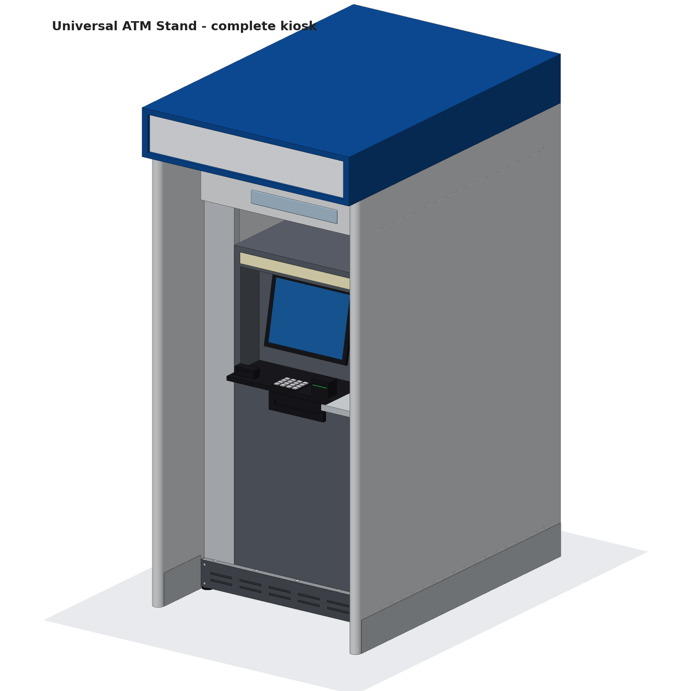

# UATM-1000 — Universal ATM Stand

A fully parametric CAD model of a universal floor-standing ATM stand: a levelled, anchored
steel plinth with a slotted universal mounting deck and adjustable stops, plus an optional
privacy surround (wings, canopy, rear service wall). It accepts most lobby ATM cabinets
without modification.



## Universal envelope

| Item | Range | How it adapts |
|---|---|---|
| Cabinet width | 480 – 780 mm | Side stops slide in 14 lateral deck slots |
| Cabinet depth | 550 – 1000 mm | Rear stop slides in 6 longitudinal slots |
| Cabinet height | ≤ 1600 mm | Below the internal ceiling plate |
| Cabinet mass | ≤ 1000 kg static | 4× M16 hold-downs, 6 feet, 8 anchors |
| Anchor pattern | any 4-bolt | Bolts land on the 18 mm slot grid; otherwise drill the 10 mm deck |
| Floor levelling | ±25 mm | 6× M20 swivel levelling feet |
| Side gap to wings | 92 – 242 mm | Telescopic stainless side trims |

Key dimensions: plinth 964 × 1154 mm, deck top +130 FFL; kiosk 1064 W × 1492 D × 2250 H,
clear width between wings 964 mm. Estimated mass: plinth kit 154 kg, complete stand 404 kg
(excluding the ATM).

## What's in this folder

| Path | Contents |
|---|---|
| `cad/ATM_Stand.FCStd` | FreeCAD document: 101 parts in assembly groups, parameter spreadsheet, per-part description / material / mass properties |
| `cad/*.step` | STEP AP214: complete (with / without reference ATM), plinth kit, privacy surround, base frame weldment, deck plate |
| `cad/Deck_Plate_10mm_S355.dxf` | Laser-cut profile of the deck plate (R12 DXF, mm) |
| `stl/` | One STL per part plus `_ATM_Stand_Complete_noATM.stl` |
| `drawings/UATM-1000_Drawing_Set.pdf` | 7 × A3 sheets (PNG copies alongside) |
| `renders/` | Shaded renders: kiosk front/rear, exploded, plinth kit, frame, plinth + ATM |
| `viewer/ATM_Stand_Viewer.html` | Self-contained interactive 3D viewer (orbit, explode, section, BOM, part inspector) |
| `BOM.csv`, `BOM.md` | Bill of materials (46 lines) with quantities and masses |
| `src/` | Parametric source (Python / FreeCAD) |

### Drawing set

| Sheet | Drawing | Scale |
|---|---|---|
| 1 | UATM-1000-GA — General arrangement, kiosk | 1:20 |
| 2 | UATM-1100 — Plinth kit assembly | 1:10 |
| 3 | UATM-1110 — Base frame weldment + cut list | 1:10 |
| 4 | UATM-1120 — Universal deck plate (ordinate dims, feature table) | 1:5 |
| 5 | UATM-1000-UF — Universal fit envelopes & reach zones | 1:10 / 1:20 |
| 6 | UATM-1000-EX — Exploded view & assembly sequence, torques | NTS |
| 7 | UATM-1000-BOM — Bill of materials | – |

## Assemblies

1. **Base frame** — RHS 80×40×3 S355 welded ladder frame (perimeter, 2 cross members, 2 segmented bearers), galvanised + RAL 7016.
2. **Levelling & anchoring** — 6× M20 swivel levelling feet, 4× corner anchor brackets, 8× M16 chemical anchors.
3. **Deck & clamp kit** — 10 mm deck with the universal slot grid and Ø120 grommeted cable entry; adjustable L60×60×6 side and rear stops with EPDM strips; 4× ATM hold-down bolts with under-deck clamp plates.
4. **Skirting** — louvred removable front service panel (security Torx), side and rear skirts, rear cable mouse-hole with brush strip.
5. **Services** — power and data conduits, IP65 junction box.
6. **Privacy wings** — 50 mm wings with round front edges, stainless kick plates, customer bag shelf.
7. **Canopy** — folded aluminium topper, illuminated sign face, LED downlight, dome camera, LED driver.
8. **Header & trims** — removable header panel, security mirror, telescopic side trims, internal ceiling plate.
9. **Rear wall & door** — service wall with 760 × 1900 door, hinges, swing handle, lock.
10. **Reference ATM** — dummy cabinet for fit checks only (not supplied).

## Changing the design

All dimensions live in [`src/atm_params.py`](src/atm_params.py). Edit them and regenerate everything:

```bash
./build.sh
```

The build needs FreeCAD 1.0 or newer (`freecadcmd` / `freecad.cmd`) and takes about 90 seconds.
Set `surround=False` for a plinth-only stand, or change `atm_w / atm_d / atm_h` to fit-check a
specific cabinet; the stops, trims and hold-downs follow automatically.

To get the model with colours in the FreeCAD GUI, open FreeCAD and run `src/build_all.py`
from **Macro → Macros… → Execute** (headless builds can't store display colours).

## Engineering notes and limits

- Masses are CAD estimates. Sheet-metal panels are modelled as solid envelopes and weighed by
  skin area; treat the STEP panels as envelopes, not flat patterns.
- The design load (1000 kg static, 2 kN horizontal at 1.2 m) is a stated design target. No FEA
  or anchor calculation has been done; have the frame, anchors and floor checked by a structural
  engineer before fabrication.
- Accessibility reach lines (380 / 1220 mm) follow ADA 2010 §308; confirm against your local code
  and the ATM OEM's interface heights.
- Fasteners are simplified (no threads); torque values in the drawings are typical figures and
  should be confirmed against the fastener and anchor suppliers' data.
